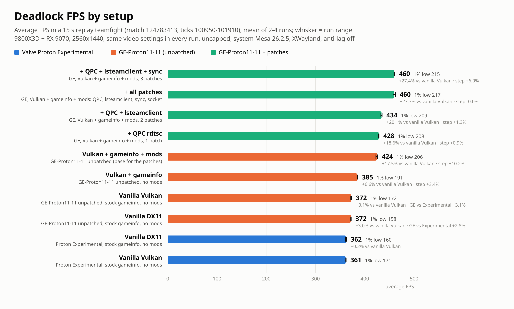

# Deadlock Linux optimizations

Wine/Proton and compositor patches for Deadlock on Linux, with measured results. Nothing here touches game files or game memory.



Measured on a Ryzen 7 9800X3D and RX 9070 at 2560x1440, Mesa 26.2.5, uncapped, in a 15 s replay teamfight (match 124783413, ticks 100950-101910). Each setup got a warm-up launch and then 2-4 measured launches; runs of the same setup were within 1% of each other. Raw numbers are in `results/fps.csv`. "gameinfo" and "mods" in the graph are a performance gameinfo.gi and addon paks that are not part of this repo.

| Change | Files | FPS | Why |
|---|---|---|---|
| GE-Proton11-11 instead of Proton Experimental | compatibility tool | +2.8 to +3.1% | Vanilla game, both renderers. |
| QPC rdtsc | `patches/wine/0001-ntdll-qpc-rdtsc.patch` plus `WINE_QPC_TSC_UNORDERED=1` | +0.9% | QueryPerformanceCounter reads the TSC with rdtsc instead of rdtscp. rdtscp waits for every earlier instruction to finish, and the engine's profiler calls QPC constantly. Timestamps taken on different threads can be up to about 300 ns out of order. The env var enables this part. The patch also keeps the clocksource file open for the once-a-second check, which removes a 20-60 µs main-thread stall; that part is always on. |
| lsteamclient | `patches/lsteamclient/0001-skip-env-sync-on-callback-polling.patch` | +1.3% | Every Steam callback poll (every frame) scanned the whole environment for SteamAppId and IgnoreChildProcesses and made a Unix call to sync them. Polling calls now skip that once steamclient is loaded; interface creation keeps the full path. |
| Sync | `patches/wine/0002-ntdll-sync-fast-paths.patch` | +6.0% | The engine creates and closes anonymous events and semaphores every frame, and each create/close costs three wineserver round trips. Closed ones are now kept and reused. SRW locks and WaitOnAddress get one-atomic fast paths, a 1024-bucket wait table and a bounded spin. |
| Socket polling | `patches/wine/0003-socket-shm-polling.patch` | no change | The network thread polls about 31 idle UDP sockets, up to 10k wineserver round trips per second. Socket event state now lives in wineserver shared memory, so idle polls and nonblocking UDP send/recv skip the server. This lowers wineserver CPU and packet handling delay, not frame time. It changes the wineserver protocol, so wineserver and both ntdll.so must be replaced together. |
| Hyprland tearing | `patches/hyprland/0001-0003` for Hyprland 0.56.2 | latency only | Wine's Wayland driver presents Vulkan frames on a subsurface, and Hyprland only schedules tearing on toplevel commits, so tearing never engages. 0002 schedules it from the solitary subsurface. 0001 stops the "not torn yet" state from blocking the first torn frame. 0003 waits for the actual pending page flip, which direct scanout does not report as busy. |
| `RADV_PERFTEST=localbos` | launch option | no change | Tested. It cuts the kernel cost of each submit, but FPS did not move (458.9 vs 458.8). |

All patch FPS numbers are cumulative, each on top of the rows above it, on GE-Proton11-11 with Vulkan. All four Wine/Proton patches together give +8.3% over unpatched GE-Proton11-11.

Vulkan and DX11 give the same average FPS, but Vulkan's 1% lows are 8% higher (171.8 vs 158.4). Use `-vulkan`.

`PROTON_USE_NTSYNC` does nothing in GE-Proton11-11. NTSYNC is used automatically when `/dev/ntsync` exists.

Prebuilt files for GE-Proton11-11 with all four Wine/Proton patches are in the release. Close Steam first, so that no wineserver is still running:

```sh
mkdir -p /tmp/dl && tar -xzf ~/Downloads/ge-proton11-11-deadlock-patched-files.tar.gz -C /tmp/dl
(cd /tmp/dl && sha256sum -c SHA256SUMS)
cd ~/.local/share/Steam/compatibilitytools.d
cp -a GE-Proton11-11-x86_64 GE-Proton11-11-deadlock
sed -i 's/"GE-Proton11-11-x86_64"/"GE-Proton11-11-deadlock"/g' GE-Proton11-11-deadlock/compatibilitytool.vdf
cp -r /tmp/dl/files GE-Proton11-11-deadlock/
```

Select GE-Proton11-11-deadlock for Deadlock and set the launch options to `WINE_QPC_TSC_UNORDERED=1 %command% -vulkan`.

To build from source, apply `patches/wine` in order to GE-Proton11-11's wine tree after GE's own patches and before `tools/make_requests`; GE's `protonprep-valve-staging.sh` runs make_requests itself. Apply `patches/lsteamclient` in the Proton source root after GE's lsteamclient patches.

For tearing on Hyprland, apply `patches/hyprland` in order with `patch -Np1` to the Hyprland 0.56.2 source. Use them with `PROTON_ENABLE_WAYLAND=1`, `MESA_VK_WSI_PRESENT_MODE=immediate`, `general:allow_tearing = true` and an immediate window rule for class `steam_app_1422450`. `hyprctl monitors` shows `activelyTearing: true` in game when it works.

The Wine patches and prebuilt files are LGPL-2.1-or-later, like Wine. The Hyprland patches are BSD-3-Clause, like Hyprland.
